<div align="center">

# 🩸 Faseelty | فصيلتي

### Smart Blood Donation & Healthcare Coordination Platform

**One Drop Can Save a Life.**


*Graduation Project 1 — Computer Science, Nile University*

</div>

---

## 📖 Table of Contents

- [About the Project](#-about-the-project)
- [The Problem](#-the-problem)
- [Key Features](#-key-features)
- [How It Works](#-how-it-works)
- [User Roles](#-user-roles)
- [System Modules](#-system-modules)
- [Database Design](#-database-design)
- [Security & Privacy](#-security--privacy)
- [Tech Stack](#-tech-stack)
- [Getting Started](#-getting-started)
- [Project Scope & Disclaimer](#-project-scope--disclaimer)
- [Roadmap](#-roadmap)
- [Team](#-team)
- [License](#-license)

---

## 🌟 About the Project

**Faseelty** (فصيلتي — "my blood group") is a smart platform that connects **voluntary blood donors** with **hospitals and blood banks**. Institutions publish their blood needs (blood group, units, urgency, date); donors see only the needs that match their blood group, offer to donate, and complete the donation at the institution.

> Faseelty does **not** collect, store, test, or dispense blood. Medical screening, blood collection, and storage are performed only inside the institution by qualified staff.

**Project aim:** shorten the time between the publication of a blood need and a confirmed donation, while keeping every medical decision with the healthcare institution.

---

## 🎯 The Problem

Blood banks and hospitals need the right donors, at the right time, especially for specific blood groups and urgent cases. Today, institutions rely on campaigns, personal contacts, social media posts, and phone calls — methods that are slow, hard to verify, and hard to follow up.

| Challenge | Impact |
| --- | --- |
| Hard to reach donors with the required blood group in time | Delayed or unfulfilled needs |
| Donors lack verified information on where and when blood is needed | Low participation |
| No centralized platform linking donors and institutions | Duplicated, scattered efforts |
| Same information re-entered at registration and check-in | Wasted time at the hospital |
| Fake accounts, no-shows, unauthorized access to medical data | Loss of trust and privacy risks |

**Context (Egypt):** annual donations are slightly below one million units while needs exceed 1.6 million units per year, according to the Ministry of Health and Population. Large-scale registration campaigns show that many people are willing to donate when they are reached through a convenient channel.

---

## ✨ Key Features

- **📢 Verified blood needs** — institutions publish needs with blood group, units, date, and urgency (*Critical / Urgent / Planned*).
- **🎯 Smart donor matching & ranking** — by blood group compatibility, distance, availability, eligibility, urgency, and time remaining.
- **🙋 Donor offers & Available Now** — one-tap offers, plus a time-limited *Available Now* status (expires automatically, no live tracking).
- **⏳ Fair waiting list** — extra offers join a waiting list; if an accepted donor taps **Unable to Attend**, the next suitable donor is notified automatically.
- **📱 QR check-in with consent** — enter your data once; the institution views it only with your consent, scoped to a specific need, time-limited, and revocable.
- **🧾 Blood group verification** — donors upload evidence, reviewed by an authorized reviewer.
- **📝 Preliminary eligibility questionnaire** — guidance only; the final decision stays with medical staff.
- **📅 Donation history & reminders** — tracks confirmed donations and the estimated next eligible date.
- **🗺️ Blood availability map** — *Available / Low / Not Available* per blood group, with last-updated time and stale-data warnings.
- **🔔 Notifications & SMS** — targeted alerts; no sensitive health data in SMS or lock-screen notifications.
- **🤖 AI chatbot** — general donation information from trusted sources (no diagnosis, no eligibility decisions).
- **🛡️ Fraud prevention & audit logs** — reporting tools, admin review, duplicate detection, and full auditing of sensitive actions.
- **🌍 Arabic-first** interface with the possibility of English support.

---

## 🔄 How It Works

```mermaid
flowchart LR
    A[Institution publishes<br/>a blood need] --> B[System matches &<br/>ranks suitable donors]
    B --> C[Donors notified<br/>or browse needs]
    C --> D{Offer}
    D -->|Within required units| E[Accepted]
    D -->|Need is full| F[Waiting list]
    F -.->|Spot released| E
    E --> G[Donor shows QR<br/>at the institution]
    G --> H[Staff view pre-filled data<br/>with donor consent]
    H --> I[Medical screening &<br/>donation by staff]
    I --> J[Donation confirmed]
    J --> K[History, next eligible date<br/>& need status updated]
```



**Need statuses:** `Open` → `Full` → `Partially Fulfilled` → `Fulfilled` (or `Cancelled` / `Expired`)

**Offer statuses:** `Offered`, `Accepted`, `Waitlisted`, `Declined`, `Withdrawn`, `Arrived`, `Completed`, `Expired`

---

## 👥 User Roles

Faseelty uses **Role-Based Access Control (RBAC)**.

| Function | Donor | Hospital / Blood Bank | Administrator |
| --- | :---: | :---: | :---: |
| Manage personal profile | ✅ | ✅ | Support only |
| Publish blood needs | ❌ | Own institution | Oversight |
| Browse needs & offer to donate | ✅ | ❌ | Oversight |
| Review offers & manage waiting list | ❌ | Own institution | Oversight |
| Upload blood group evidence | ✅ | ❌ | Review |
| Confirm donation completion | ❌ | Authorized staff | Audit |
| Share data via QR with consent | ✅ (own data) | With consent only | No health data by default |
| Update blood availability | ❌ | Own institution | Audit |
| View availability map | ✅ | ✅ | ✅ |
| Report suspicious activity | ✅ | ✅ | Review & action |

> Institutional accounts must be reviewed and verified by an administrator before receiving hospital/blood bank permissions.

---

## 🧩 System Modules

| # | Module | Responsibility |
| :-: | --- | --- |
| 1 | Authentication | Registration, login, OTP verification, account recovery |
| 2 | User Management | Profiles, account types, permissions |
| 3 | Institution Management | Hospital & blood bank registration and verification |
| 4 | Blood Need | Need creation, urgency, status updates, closure |
| 5 | Donor Matching | Filtering and ranking donors and needs |
| 6 | Offers & Waiting List | Offers, Available Now, waiting list, Unable to Attend |
| 7 | Blood Group Verification | Document upload and review |
| 8 | Eligibility Questionnaire | Preliminary information collection |
| 9 | Donation History | Confirmed donations and reminders |
| 10 | QR Code & Consent | Donor identification, consent records, consent-based access |
| 11 | Notifications | Push, in-app, and SMS |
| 12 | Availability & Map | Locations, availability, last-updated tracking, directions |
| 13 | AI Chatbot | General information from trusted sources |
| 14 | Fraud Prevention | Reporting, investigation, suspicious activity monitoring |
| 15 | Administration | Platform management, audit logs, aggregated analytics |

---

## 🗄️ Database Design

The initial schema is provided as a **MySQL 8** script (`faseelty_schema.sql`) covering the core entities:

`Users` · `UserRoles` · `DonorProfiles` · `BloodGroups` · `BloodGroupVerifications` · `Institutions` · `InstitutionUsers` · `InstitutionVerifications` · `BloodNeeds` · `DonorOffers` · `DonorAvailability` · `EligibilityResponses` · `Donations` · `Notifications` · `QRCodeRecords` · `ConsentRecords` · `BloodAvailability` · `Reports` · `ChatSessions` · `AuditLogs`

**Key design rules**

- A donor can have **at most one active offer per need**.
- Waiting-list positions are assigned and promoted **inside transactions** to avoid conflicts.
- Duplicate donation confirmations are prevented by validation and transaction handling.
- Blood group verification records are **separate** from donor profiles to preserve review history.
- Sensitive documents are stored securely; the database keeps **controlled references**, never public links.
- QR codes contain **only a secure identifier** — no personal or medical data.
- Every availability update stores the **timestamp and staff member**.

---

## 🔐 Security & Privacy

- Secure authentication and authorization with RBAC
- Encryption of sensitive data in transit and at rest
- Secure document upload and storage
- Data minimization — only necessary information is collected
- Consent is **scoped, time-limited, and revocable**; every consent and data access is logged in audit logs
- No sensitive health information in SMS or lock-screen notifications
- Audit logs for institutional verification, donation confirmation, and administrative changes
- Voluntary, non-remunerated donation only — **no payment for blood**

---

## 🛠️ Tech Stack

> ✏️ *Update this section with the technologies you actually used.*

| Layer | Technology |
| --- | --- |
| Frontend | _e.g. React / Flutter_ |
| Backend | _e.g. Node.js / ASP.NET / Django_ |
| Database | MySQL 8 |
| Notifications / SMS | _SMS gateway + push service_ |
| Maps | _Maps & geolocation API_ |
| AI Chatbot | _LLM API_ |

---

## 🚀 Getting Started

> ✏️ *Adjust the commands below to match your project structure.*

### Prerequisites

- MySQL 8.0+
- _Runtime for your backend (Node.js / .NET / Python …)_
- Git

### Installation

```bash
# 1. Clone the repository
git clone https://github.com/<your-username>/faseelty.git
cd faseelty

# 2. Create the database
mysql -u root -p -e "CREATE DATABASE faseelty CHARACTER SET utf8mb4 COLLATE utf8mb4_unicode_ci;"

# 3. Import the schema
mysql -u root -p faseelty < faseelty_schema.sql

# 4. Configure environment variables
cp .env.example .env
#   → set DB credentials, SMS provider keys, map API key, AI API key

# 5. Install dependencies and run
#   (replace with your project's commands)
```

> **Note:** `faseelty_schema.sql` targets **MySQL 8**. It uses MySQL-specific syntax (e.g. backticks, `IF NOT EXISTS`, `UNSIGNED`) and will not run unmodified on SQL Server.

---

## ⚠️ Project Scope & Disclaimer

Faseelty is an **academic prototype** that uses **test data** and is **not intended for real emergency cases**.

- Final medical decisions — eligibility, testing, collection, storage — remain with qualified staff of the healthcare institution.
- The eligibility questionnaire and reminders are **preliminary guidance only**.
- Availability shown on the map is provided by institutions and **does not guarantee** that blood is available.
- Any real-world deployment requires coordination and approval from the relevant healthcare institutions and authorities, and compliance with Egyptian data protection requirements.

---

## 🗺️ Roadmap

- [x] **Phase 1** — Requirements, workflow, modules, and data model for donor ↔ institution coordination
- [ ] Validate assumptions through an anonymous survey (50–100 respondents)
- [ ] Build the prototype with test data
- [ ] Coordinate with participating healthcare institutions
- [ ] **Phase 2** — Patient & family blood requests, confirmed by the institution and linked to the donor network
- [ ] Appointment scheduling for donation
- [ ] ML-based prioritization and regional demand prediction
- [ ] Integration with approved hospital and blood bank systems
- [ ] Additional language support and accessibility improvements

---

## 👩‍💻 Team

**Nile University — Computer Science — Graduation Project 1**

| Team Members |
| --- |
| Mariam Radwan |
| Yasmen Ahmed |
| Habiba Mohamed |
| Ola Ahmed |
| Salma Khaled |
| Mohamed Sherif |

**Supervised by:** Dr. Islam Tharwat · Eng. Ismail Ahmed

---

## 📄 License

Distributed under the **MIT License**. See [`LICENSE`](LICENSE) for details.

---

<div align="center">

**Faseelty — One Drop Can Save a Life.** 🩸

</div>
