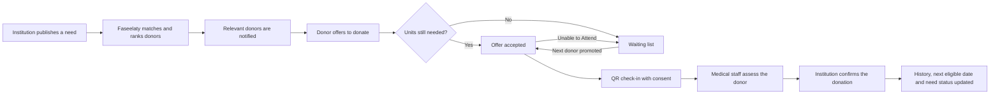

# Faseelaty — فصيلتي

**Smart blood donation and healthcare coordination platform**
*One Drop Can Save a Life.*

> **Status:** Graduation Project 1 (Computer Science, Nile University). Requirements, workflow, modules and system architecture are defined, and the **PostgreSQL database schema is built and tested** with demo data (5,000 donors across 60 institutions). The academic prototype is in progress. Faseelaty is **not** intended for real emergency cases.

---

## Overview

Faseelaty connects **voluntary blood donors** with **blood banks and hospitals**.
Institutions publish their blood needs (blood group, units, urgency and date). Donors see the needs that match their blood group, offer to donate, and complete the donation at the institution.

Faseelaty does **not** collect, store, test or dispense blood. Medical screening, collection and storage are done only inside the institution by qualified staff.

## The problem

- Blood banks and hospitals struggle to reach donors with the right blood group in time.
- Donors don't have clear, verified information about where and when blood is needed.
- Requests are spread across campaigns, phone calls and social media posts that are hard to verify and follow up.
- Donors fill in the same information at registration and again at check-in.
- Fake accounts, no-shows and unauthorised access to medical information are real risks.

**Some numbers (Egypt):**

| | |
|---|---|
| Annual donations | slightly below **1 million units**, while needs exceed **1.6 million units** a year [[10]](#references) |
| Donor participation | around **1%** of the population [[14]](#references) |
| Willingness to donate | **15,000+** people registered in **12 hours** in a June 2026 national campaign (Guinness World Record) [[16]](#references) |

Many people are willing to donate when they are reached easily. What's missing is a simple, verified channel between them and the institutions.

## Project goals

- Connect blood donors with healthcare institutions.
- Improve the organization of blood donation requests.
- Reduce the time needed to coordinate donations.
- Protect donor privacy and personal information.
- Encourage voluntary blood donation.

## Key features (phase 1)

- **Blood needs** published by verified institutions, with urgency levels: *Critical*, *Urgent*, *Planned*
- **Smart matching and ranking** by blood-group compatibility, distance, availability, eligibility and urgency; notifications go only to relevant donors
- **Donor offers** with one tap, an **Available Now** status, and a **waiting list**; if an accepted donor taps *Unable to Attend*, the next donor is notified automatically
- **Blood group verification** through an uploaded donation card or lab result, reviewed by an authorised reviewer
- **Preliminary eligibility questionnaire** (guidance only; final decisions stay with medical staff)
- **QR check-in with consent-based data sharing**: the donor enters information once, and the institution views it only with time-limited consent
- **Donation history and reminders** with the next estimated donation date
- **Blood availability map** based on institution data, always showing the *last updated* time
- **Notifications and SMS** for relevant needs
- **AI chatbot** for general donation information from trusted sources
- **Fraud prevention and audit logs**
- **Arabic first**, with a right-to-left layout from the first screen (English optional)

## User roles

| Function | Donor | Hospital / Blood bank | Administrator |
|---|---|---|---|
| Publish blood needs | — | Own institution | Oversight |
| Browse needs and offer to donate | ✓ | — | Oversight |
| View offers and the waiting list | — | Own institution | Oversight |
| Upload blood-group evidence | ✓ | — | Review (reviewer role) |
| Share data through QR (with consent) | Own data | Only with consent | No health data by default |
| Confirm donation completion | — | Authorised staff | Audit |
| Update blood availability | — | Own institution | Audit |
| View the availability map | ✓ | ✓ | ✓ |
| Report suspicious activity | ✓ | ✓ | Review and action |

Institutional accounts are verified by the administrator before they get institution permissions.

Inside the system these map to five roles: **donor**, **institution staff**, **institution administrator**, **platform admin** and **reviewer** (reviews blood-group evidence). Platform admins have no default access to donor health data.

## How it works



**Need statuses:** Open · Partially Fulfilled · Fulfilled · Cancelled · Expired
**Offer statuses:** Offered · Accepted · Waitlisted · Declined · Withdrawn · Arrived · Completed · Expired

An offer is accepted automatically while units are still needed; otherwise it joins the waiting list. *Unable to Attend* marks the offer **Withdrawn** and promotes the highest-ranked waitlisted donor. A QR scan alone never completes a donation: authorised staff confirm it.

## Architecture

Faseelaty is a **modular monolith**: one backend codebase split into 15 modules, one PostgreSQL database, one background worker, and the client apps. Each module owns its tables and talks to other modules only through their service interfaces, so modules can be split into services later if needed.

| Layer | Components |
|---|---|
| Clients | React Native mobile app (donors and institution staff); React web dashboard (institution staff and admins) |
| API | REST over HTTPS with JSON, versioned under `/v1`, documented with OpenAPI; authentication, role guard, institution scoping, validation, rate limiting |
| Application | 15 backend modules (below) |
| Async | Redis-backed job queue, background worker, scheduler |
| Data | PostgreSQL with PostGIS, Redis, private object storage for documents |
| External services | Push notifications, SMS gateway, maps, AI model API |
| Cross-cutting | Security, audit logging, monitoring, CI/CD, backups |

**Scheduled jobs:** expire *Available Now*, expire needs and offers past their deadline, flag stale blood availability, send donation reminders, expire QR codes and consents, and apply data-retention cleanup.

## System modules

| # | Module | Responsibility |
|---|---|---|
| 1 | Authentication | Registration, login, OTP verification, account recovery |
| 2 | User Management | Profiles, account types, permissions |
| 3 | Institution Management | Hospital and blood bank registration and verification |
| 4 | Blood Need | Need creation, urgency, status updates, closure |
| 5 | Donor Matching | Filtering and ranking donors and needs |
| 6 | Offers and Waiting List | Offers, Available Now, waiting list, Unable to Attend |
| 7 | Blood Group Verification | Document upload and review |
| 8 | Eligibility Questionnaire | Preliminary information collection |
| 9 | Donation History | Confirmed donations and reminders |
| 10 | QR Code and Consent | Donor identification, consent records, check-in access |
| 11 | Notifications | Push, in-app and SMS |
| 12 | Blood Availability and Map | Locations, availability, last-updated tracking, directions |
| 13 | AI Chatbot | General information from trusted sources |
| 14 | Fraud Prevention | Reporting, investigation, monitoring |
| 15 | Administration | Platform management, audit logs, analytics |

## Data model (main entities)

`Users` · `UserRoles` · `DonorProfiles` · `BloodGroups` · `BloodGroupVerifications` · `Institutions` · `InstitutionUsers` · `InstitutionVerifications` · `BloodNeeds` · `DonorOffers` · `DonorAvailability` · `EligibilityResponses` · `Donations` · `Notifications` · `QRCodeRecords` · `ConsentRecords` · `BloodAvailability` · `Reports` · `ChatSessions` · `AuditLogs`

The schema has 20 main entities plus 4 supporting tables, with its rules enforced by the database itself.

Main relationships: a user has one donor profile; institutions and users are linked many-to-many through `InstitutionUsers`; an institution has many blood needs; a blood need has many donor offers; an offer can have one QR code record, consent records and one donation.

Key design rules:
- A QR code holds only a random opaque token (stored hashed, tied to one offer, with an expiry), never personal or medical data.
- At most one active offer per donor per need (partial unique index), and at most one donation per offer (unique constraint).
- Offers and waiting-list promotions run inside database transactions with row locking, so simultaneous offers or withdrawals cannot over-fill a need or promote the same donor twice.
- Blood-group compatibility comes from a `BloodCompatibility` lookup table, not hard-coded logic.
- Consent is time-limited and linked to one offer, and every consent change and institution access is written to the append-only audit log in the same transaction as the action.
- Every availability update stores who made it and when; all timestamps are stored in UTC and shown in Cairo time.

## Tech stack

| Part | Choice |
|---|---|
| Mobile app | **React Native + TypeScript (Expo)**: one code base for Android and iOS, with QR scanning and push notifications |
| Web dashboard | **React + TypeScript** for institution staff and admins |
| Backend | **Node.js + TypeScript (NestJS)** |
| Database | **PostgreSQL + PostGIS** (distance queries, transactions, constraints) |
| Data access | Prisma or Drizzle, plus raw SQL for geo queries and the waiting-list transaction |
| Queue & cache | Redis + BullMQ |
| File storage | Private S3-compatible bucket (documents are never public; short-lived signed URLs) |
| Push notifications | Firebase Cloud Messaging |
| Authentication | Short-lived JWT access token, rotating refresh token, SMS OTP; passwords hashed with argon2id |
| Infrastructure | Docker, GitHub Actions, one cloud host, managed PostgreSQL with daily backups |
| Monitoring | Structured logs, Sentry, health-check endpoint |
| Still to decide | SMS gateway (Egyptian numbers), maps provider, hosting provider, chatbot source list |

## Repository structure

```
faseelaty/
  apps/
    api/        NestJS backend (15 modules)
    worker/     queue consumers and scheduled jobs
    mobile/     React Native (Expo) app
    web/        React dashboard for institutions and admins
  packages/
    shared/     TypeScript types, validation schemas, constants
  infra/        Docker Compose, deployment config
  docs/         architecture, API reference, database design
```

## Getting started

> Setup instructions will be added as the prototype is built.

Locally, Docker Compose runs the API, worker, PostgreSQL and Redis. Secrets live in environment variables and are never committed to the repository.

## Privacy, safety and constraints

- **Medical decisions** (eligibility, testing, collection, storage) stay with the institution's qualified staff.
- **Voluntary donation only**: no payment for blood, in line with Egypt's 1999 ban on paid donors [[17]](#references).
- **Institution features** stay locked until the institution is verified.
- **Access control in three layers**: valid login, role, and institution scope (staff only ever see their own institution's data).
- **Data protection**: TLS for all traffic, encryption at rest, rate limits on login, OTP, offers and reports, and a cap on SMS per donor.
- **Privacy**: no health details in SMS or lock-screen notifications; *Available Now* stores only an approximate area, never live location; questionnaire answers and chat sessions are deleted or anonymised under a retention policy.
- **AI chatbot**: called only from the backend, answers only from curated trusted sources, never diagnoses or makes eligibility decisions, and no personal health data is sent to the model.
- **Real-world use** requires approval from health institutions and authorities, and compliance with Egypt's Personal Data Protection Law (Law 151 of 2020).

## Roadmap

- **Done:** requirements, system architecture, database schema with demo data
- **Prototype build order:**
  - **A. Foundation:** repository, CI, database schema, authentication, users, roles, institutions and verification
  - **B. Core loop:** blood needs, matching, offers, Available Now, waiting list, notifications
  - **C. Check-in:** QR, consent, audit log, donation confirmation, history, reminders
  - **D. Visibility:** blood availability map, admin dashboard, statistics
  - **E. Extras:** blood-group verification polish, chatbot, fraud reports, hardening
- **Also next:** validate assumptions with a survey (50–100 respondents) and coordinate with a pilot hospital
- **Phase 2 — patient requests:** patient and family accounts, hospital-confirmed requests linked to the donor network, request tracking and request QR codes (a confirmed patient request becomes a blood need, so it reuses the same matching and offer pipeline)
- **Later:** demand prediction, integration with approved hospital and blood-bank systems, appointment scheduling, more languages, accessibility improvements

## Project scope

This repository currently holds the project documentation and related materials. The database schema has been built and tested and will be added here; the mobile app, web dashboard and backend will be added as the prototype is built.

## Documentation

- Full project documentation (market research, SWOT, detailed functional and non-functional requirements, references): [`docs/HAYAH_Documentation.docx`](docs/HAYAH_Documentation.docx)
- System architecture (stack, modules and endpoints, security, critical flows, data design, build order): [`docs/HAYAH_System_Architecture.pdf`](docs/HAYAH_System_Architecture.pdf)

## Team

**Prepared by:** Mariam Radwan · Yasmen Ahmed · Habiba Mohamed · Ola Ahmed · Salma Khaled · Mohamed Sherif
**Supervised by:** Dr. Islam Tharwat · Eng. Ismail Ahmed
Computer Science — Graduation Project 1, Nile University

## References

Selected sources (the full list of 18 references is in the documentation):

- [10] Egypt Telegraph — Needs exceed 1.6 million blood units annually (Arabic): https://www.egypttelegraph.com/article/240540/
- [11] Youm7 (10 Jul 2026) — National blood transfusion services, first half of 2026 (Arabic): https://www.youm7.com/7477055
- [14] LG Egypt × Misr El-Kheir — Blood donation initiative (Arabic): https://www.lg.com/eg_ar/lg-story/news/LG-Blood-Donation-with-Mirs-El-Kheir-Foundation
- [16] Ahram Online (2 Jul 2026) — Guinness World Record for blood donor registrations in 12 hours: https://english.ahram.org.eg/News/572087.aspx
- [17] Mada Masr via Worldcrunch — Why blood donation is in such short supply in Egypt: https://worldcrunch.com/tech-science/why-blood-donation-is-in-such-short-supply-in-egypt/
